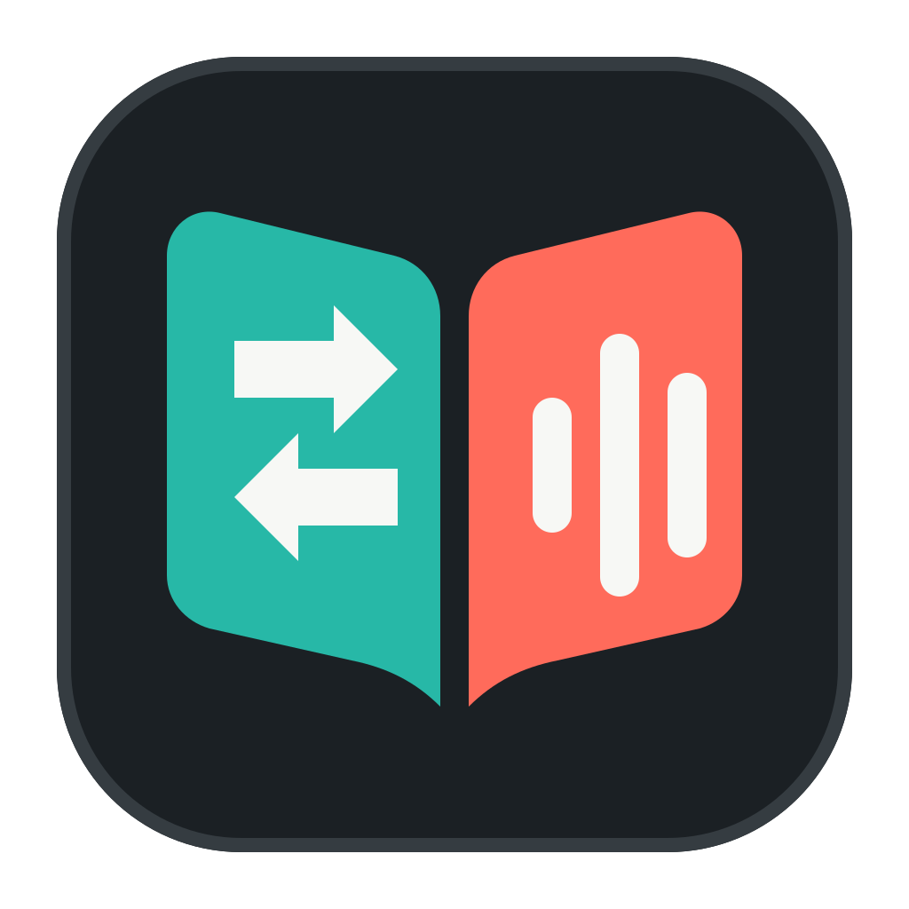

# 译读

<p align="center">
  
</p>

译读是一款使用 AutoHotkey v2 编写的 Windows 划词翻译与在线朗读工具。选中文字后按下快捷键，即可进行中英互译或朗读；未选中文字时，会自动打开输入窗口。

> [!IMPORTANT]
> **EXE 版本未进行数字签名，可能被 Windows Defender 或其他杀毒软件误报。推荐通过 [Microsoft Store](https://apps.microsoft.com/detail/9MTM3STZL8L1) 下载和安装。**

<p align="center">
  <a href="https://apps.microsoft.com/detail/9MTM3STZL8L1">
    
  </a>
</p>

## 功能

- 自动获取当前选中的文本，同时保留原剪贴板内容
- 根据文本内容自动选择中文或英文作为目标语言
- 支持腾讯、有道和谷歌免费翻译接口，并记住上次选择
- 原文与译文在同一窗口上下显示，原文可编辑、收起和展开，支持一键粘贴与清空
- 支持切换源语言、目标语言和翻译服务后自动重新翻译
- 在鼠标指针附近显示翻译结果
- 支持长文本分段翻译、失败重试和请求超时处理
- 支持结果复制、窗口置顶和翻译结果朗读
- 长文本朗读优先按句末或换行分段，首段最多 200 字、后续最多 500 字；首段完成即播放，并提前合成下一段
- 支持中文普通话、方言、粤语、台湾腔及英语音色
- 支持 0.75×、1×、1.25×、1.5× 和 2× 朗读速度，并记住上次选择
- 支持开机自启、管理员模式和托盘菜单设置
- 支持跟随系统、深色、浅色界面以及可选的窗口半透明效果

## 运行要求

- Windows 10 或 Windows 11
- [AutoHotkey v2](https://www.autohotkey.com/)
- 可访问在线翻译和语音服务的网络连接

本项目不需要申请 API Key。

## 安装

前往 [Microsoft Store](https://apps.microsoft.com/detail/9MTM3STZL8L1) 获取译读。Microsoft Store 会负责安装并自动提供后续更新。

## 从源码运行

```powershell
git clone https://github.com/zero-ljz/yidu.git
cd yidu
```

安装 AutoHotkey v2 后，双击 `YiDu.ahk` 即可运行。请将 `YiDu.ico` 与脚本放在同一目录，以显示译读的托盘图标。

需要编译为独立可执行文件时，可以使用 AutoHotkey 自带的 Ahk2Exe，并选择 `YiDu.ico` 作为图标。

## 构建 MSIX

构建 x64 MSIX 需要安装 AutoHotkey v2（含 Ahk2Exe）和 Windows SDK（含 MakeAppx、SignTool 与 Windows Runtime 元数据）。运行：

```powershell
powershell -NoProfile -ExecutionPolicy Bypass -File .\packaging\msix\build-msix.ps1
```

脚本会从 `YiDu.ahk` 的 Ahk2Exe 指令读取版本，编译主程序和开机启动任务组件，并在 `release` 目录生成经过开发证书签名的 `.msix` 与对应 `.cer`。MSIX 图标仅在缺失，或原图 `assets/yidu-icon.png`、生成脚本比输出图片更新时重新生成；需要强制更新时可运行 `.\packaging\msix\generate-assets.ps1 -Force`。首次旁加载可运行：

```powershell
.\packaging\msix\install-development-msix.ps1 `
  -PackagePath .\release\YiDu-1.5.1-MSIX-x64.msix
```

安装脚本会请求管理员权限，将开发证书导入本机信任区并安装包。正式提交 Microsoft Store 时，脚本会自动使用 Partner Center 分配给译读的包标识和发布者，并生成不带开发签名的商店包：

```powershell
.\packaging\msix\build-msix.ps1 -Mode Store
```

商店包清单使用 `zero-ljz.65035B1959F4`、`CN=2393B316-80C9-466F-AA0D-A54F1924BC33` 和发布者显示名称 `zero-ljz`。产品的 Microsoft Store ID 为 `9MTM3STZL8L1`。

MSIX 清单声明 `runFullTrust`，用于全局快捷键、选区读取、剪贴板、托盘程序和本地配置。MSIX 版本不提供管理员模式，并通过 Windows StartupTask 管理开机自启。

提交前可参考 [Microsoft Store 审核说明](packaging/msix/STORE-CERTIFICATION-NOTES.md) 核对受限能力、启动任务和隐私披露。

## 朗读测试

安装 AutoHotkey v2 后，可运行离线检查，验证托盘菜单、默认设置、音色选择、输入窗口布局、草稿恢复、翻译取消、分段、连续播放队列、暂停与继续、超时与停止清理：

```powershell
powershell -NoProfile -ExecutionPolicy Bypass -File .\tests\run-speech-tests.ps1
```

默认测试包含语音鉴权 v2 的固定向量、五分钟时间窗口与服务端时钟校正。添加 `-Online` 可验证真实语音合成和 Windows 播放接口；该检查仅提交固定测试文本，并静音播放。

添加 `-TranslationOnly` 可单独检查统一翻译窗口、图标提示、原文折叠、自动高度及上下限、粘贴清空、草稿保留和请求替换；再添加 `-TextButtons` 可检查缺少图标字体时的文字按钮布局。

## 使用方法

| 操作 | 默认快捷键 | 说明 |
| --- | --- | --- |
| 翻译 | `Ctrl + F1` | 在统一翻译窗口中翻译选中文字；没有选中文字时打开窗口输入原文 |
| 朗读 | `Ctrl + F2` | 朗读选中的文本；没有选中文本时打开输入窗口并选择音色 |

翻译窗口上方为原文，下方为译文。原文标题旁的箭头可收起／展开输入区；右侧按钮按“清空、粘贴、翻译”排列，悬停显示操作名称。“粘贴”用剪贴板文字替换原文并展开输入区，“清空”清除原文和译文并取消当前请求。原文中按 `Enter` 或点击翻译图标提交，按 `Shift + Enter` 插入换行。窗口支持朗读、复制译文、置顶和拖动。

尚未翻译时，译文区域和相关操作按钮隐藏；开始翻译后显示，清空后重新隐藏。译文区域始终只读，可选中文字或使用复制按钮。重新翻译期间保留原译文区域高度，翻译按钮切换为停止图标，悬停提示“取消翻译”，点击即可取消当前请求并保留窗口；完成、失败、取消、清空或关闭窗口后恢复翻译图标。

原文和译文根据内容及实际换行自动调整高度：原文为 64–220、译文为 64–360 个逻辑像素，超过上限时滚动查看。只有原文时，窗口展开的最小高度为 192，收起时为 118；显示译文后分别为 290 和 218，自动调整时最大高度为 742，并受当前屏幕可用高度限制。窗口边缘和四角只支持调整宽度，高度由内容决定；调整宽度后会重新计算换行和高度。

最大化时，原文和译文均分可用高度，不受自动高度上限限制；收起原文后，译文填满可用区域。尚无译文时，原文填满可用区域。还原窗口后恢复按内容自动调整高度。

源语言默认自动检测，目标语言默认自动中英互译，也可手动选择中文、英语、日语、韩语、法语、德语、西班牙语和俄语。切换源语言、目标语言或腾讯／有道／谷歌服务后，会使用当前原文自动重新翻译；如有请求正在进行，会先取消旧请求。修改原文后点击“翻译”即可重译。

顶部语言选择使用“源语言下拉框 ⇄ 目标语言下拉框”的紧凑布局，悬停可查看各自用途。中间的交换图标可交换语言，并使用当前原文自动重新翻译。自动选项会按当前中英互译方向转换为明确的语言选择。

在托盘“设置 → 快捷键”中，点击翻译或朗读的快捷键后直接按下新的组合键，支持 Ctrl、Alt、Shift、Win 及功能键。录入时按 `Esc` 取消、按 `Backspace` 或 `Delete` 清除。保存后立即生效，并同步托盘菜单与提示；“恢复默认”需保存后生效，取消或关闭窗口会保留原设置。翻译与朗读不能设为同一快捷键。

朗读输入窗口使用单个音色下拉框列出所有音色，打开时自动定位到上次使用的音色。

窗口中的折叠、粘贴、清空、翻译、钉住、朗读控制和关闭按钮使用 Windows 系统图标，悬停可查看操作名称。图钉选中时高亮，朗读控制随播放状态切换图标。系统缺少所需图标字体时，自动恢复为文字按钮。

翻译结果窗口同样使用紧凑图标按钮，提供钉住、暂停／继续、朗读／停止、复制和关闭操作。复制成功后，复制图标短暂显示为对勾。图标按钮与输入窗口保持相同尺寸和主题，并支持文字回退。

音色右侧的倍速按钮依次循环切换 0.75×、1×、1.25×、1.5× 和 2×，也可在“设置 → 翻译与朗读”中选择。默认 1×，修改后对下一次朗读生效。

翻译窗口未钉住时失焦自动隐藏，钉住后保持打开。隐藏或关闭后会在本次运行的内存中保留原文、译文和语言选择，重新打开即可继续编辑。从托盘打开时，未钉住的窗口居中，已钉住的窗口保留当前位置；选取新文字直接翻译时会按设置显示在鼠标旁，替换原文，并默认收起原文区，需要查看或编辑时可手动展开。翻译过程中关闭或失焦隐藏窗口会取消当前请求。朗读输入窗口失焦关闭时会保留草稿和光标位置，重新打开可继续输入。

朗读输入窗口点击“朗读”后保持打开，文本仍可编辑。播放期间主按钮切换为“暂停／继续”，右侧按钮为“停止”；结束或停止后恢复“朗读”，保留文本供再次朗读。关闭或失焦只收起窗口并保留文本，后台朗读继续，重新打开后与托盘同步当前播放状态。修改文本、音色和语速对下一次朗读生效。

托盘的“暂停朗读／继续朗读”和翻译结果窗口的“暂停／继续”按钮同步控制当前朗读。暂停会保留播放位置，正在合成的分段可以完成，但不会自动播放；继续后从暂停处接着读。“停止朗读”会结束当前朗读并清理音频。

托盘菜单按以下顺序排列：

- 翻译、朗读（显示当前快捷键）
- 暂停朗读／继续朗读（合成或播放期间可用）
- 停止朗读（合成或播放期间可用）
- 设置（直接打开统一设置窗口）
- 打开数据目录
- 关于译读
- 退出

设置窗口分为“常规”“翻译与朗读”“快捷键”三个标签页：

- 常规：主题、窗口半透明、结果位置、开机自启和管理员启动（MSIX 版本不提供）。
- 翻译与朗读：翻译服务、音色、语速、在线服务授权及隐私政策。
- 快捷键：点击按钮录入翻译和朗读组合键。

标签栏使用文字和下划线标识当前页面，支持 `Ctrl + Tab` / `Ctrl + Shift + Tab` 切换；焦点在标签上时也可用左右方向键切换。

主题和窗口半透明均可即时预览，点击“保存”才永久保存；取消或关闭窗口会恢复原来的主题和透明效果。其他修改点击“保存”后统一生效，“取消”或关闭窗口会丢弃草稿。“恢复默认”仅重置当前标签页，仍需保存。管理员启动方式在下次启动时生效，保存后可选择立即重启。输入窗口仍保留翻译服务、音色和语速的快捷切换。

首次使用会显示在线服务选择窗口；完成选择后，后续启动保持静默。

## 配置

首次运行时，源码版和绿色版会在自身所在目录生成 `YiDu.ini`；MSIX 版本则保存在 `%APPDATA%\YiDu\YiDu.ini`：

```ini
[Settings]
Hotkey=^F1
SpeakHotkey=^F2
SpeechVoice=zh-CN-XiaoyiNeural
SpeechSpeed=1
TranslationService=tencent
RunAsAdmin=0
ShowResultAtMouse=1
ColorTheme=system
WindowTransparency=0
PrivacyChoiceMade=0
OnlineServicesConsent=0
```

| 配置项 | 说明 |
| --- | --- |
| `Hotkey` | 翻译快捷键 |
| `SpeakHotkey` | 朗读快捷键，不能与翻译快捷键相同 |
| `SpeechVoice` | Microsoft Edge 在线语音的音色标识 |
| `SpeechSpeed` | 朗读倍速，可选 `0.75`、`1`、`1.25`、`1.5`、`2`，默认 `1` |
| `TranslationService` | 翻译服务，可选 `tencent`、`youdao` 或 `google` |
| `RunAsAdmin` | 是否以管理员身份启动，`1` 为开启 |
| `ShowResultAtMouse` | 是否在鼠标指针附近显示结果，`1` 为开启 |
| `ColorTheme` | 窗口主题，可选 `system`、`dark` 或 `light`，默认跟随系统 |
| `WindowTransparency` | 是否启用窗口半透明效果，`1` 为开启，新用户默认关闭，已有设置保留 |
| `PrivacyChoiceMade` | 是否已完成首次在线服务选择，`1` 表示已选择 |
| `OnlineServicesConsent` | 是否允许向所选第三方发送待翻译或朗读文本，`1` 为允许 |

也可手动修改快捷键，配置值使用 AutoHotkey 语法，例如 `^` 表示 `Ctrl`、`+` 表示 `Shift`、`!` 表示 `Alt`、`#` 表示 `Win`。可视化窗口会保留未修改的手动配置。

## 网络与隐私

译读可使用腾讯、有道或谷歌的免费翻译接口处理翻译请求，并使用 Microsoft Edge 在线语音服务合成朗读音频。翻译或朗读时，对应文本会发送到所选第三方在线服务，请勿处理不适合上传的敏感内容。

首次运行时，译读会在发送任何文本前征求在线服务授权。你可以在“设置 → 翻译与朗读”中随时撤回或重新给予同意，点击“保存”后生效；撤回会停止正在进行的在线翻译和朗读。

这些在线接口可能随服务方调整而发生变化，稳定性和可用性不由本项目保证。

## 联系与反馈

- 软件作者：zero-ljz（空心）
- 开源仓库：[github.com/zero-ljz/yidu](https://github.com/zero-ljz/yidu)
- 官方网站：[yidu.iapp.run](https://yidu.iapp.run)
- 反馈邮箱：[hi@iapp.run](mailto:hi@iapp.run)

## 许可证

译读主体使用 [MIT License](LICENSE)。语音鉴权模块 [speech/EdgeSpeechToken.ahk](speech/EdgeSpeechToken.ahk) 改编自 [edge-tts](https://github.com/rany2/edge-tts)，使用 LGPL-3.0-only；许可原文见 [第三方许可](third-party/edge-tts-LICENSE.txt) 和 [GPLv3](third-party/GPL-3.0.txt)。

MSIX 包内的 `source` 目录包含主程序、鉴权模块源码与许可文本，可按“从源码运行”中的说明修改并重新编译主程序。
